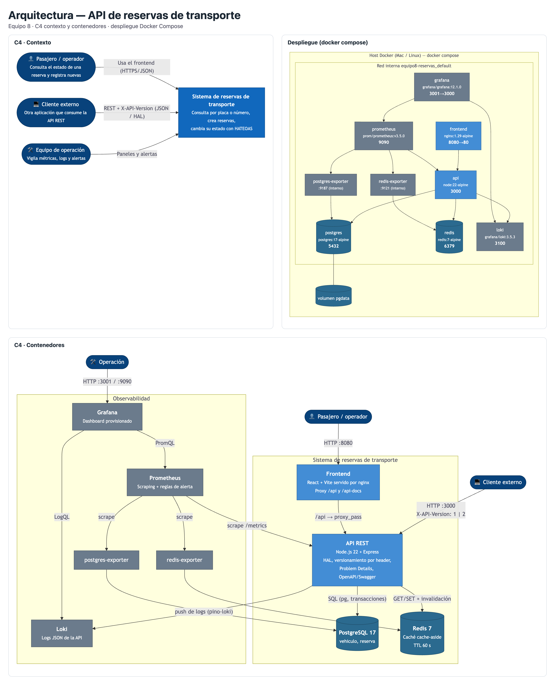
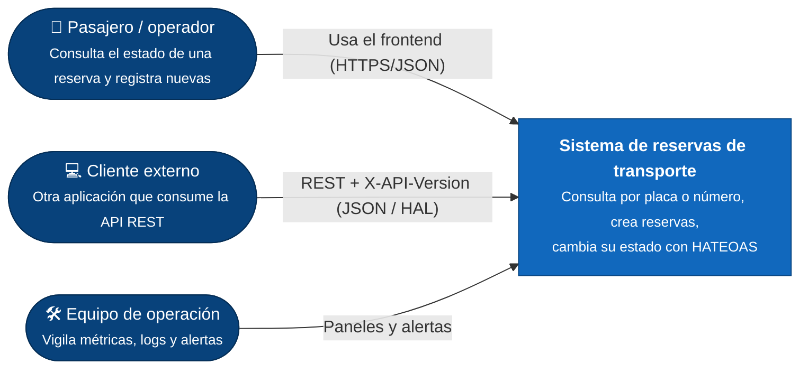
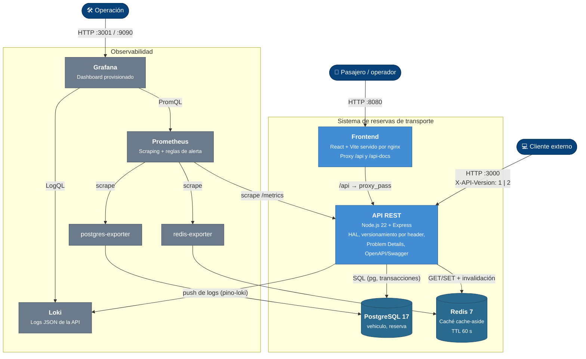
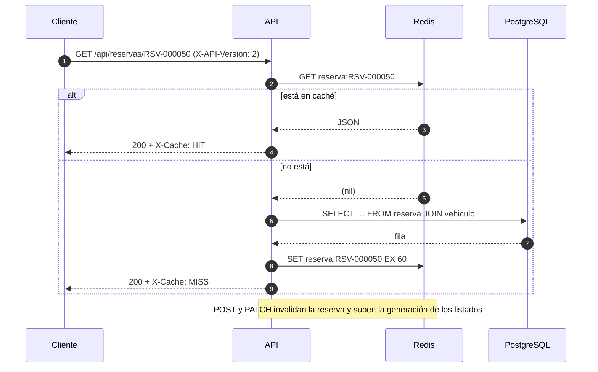
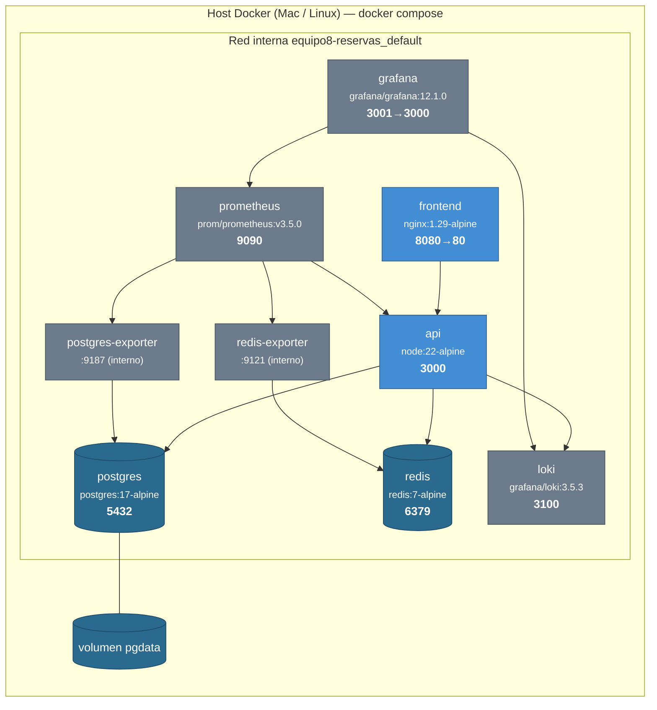

# Arquitectura — API de reservas de transporte (Equipo 8)

Los diagramas siguen el modelo **C4** (contexto y contenedores) y se completan con la vista de **despliegue** en Docker Compose. Están escritos en Mermaid, así que GitHub los dibuja directamente; la imagen [`evidencias/arquitectura.png`](evidencias/arquitectura.png) es la misma vista exportada.

## 1. Contexto (C4 nivel 1)

Quién usa el sistema y con qué se relaciona.

## 2. Contenedores (C4 nivel 2)

Las piezas que se despliegan y cómo se hablan.

### Flujo de una consulta (cache-aside)

## 3. Despliegue

Todo corre en un único host con Docker Compose (proyecto `equipo8-reservas`), en una red interna donde los contenedores se resuelven por nombre de servicio.

| Contenedor | Imagen | Puerto publicado | Depende de |
|---|---|---|---|
| `frontend` | build `./frontend` (nginx) | 8080 | api (healthy) |
| `api` | build `./api` (Node 22) | 3000 | postgres, redis (healthy), loki |
| `postgres` | `postgres:17-alpine` | 5432 | — (volumen `pgdata`, `init.sql`) |
| `redis` | `redis:7-alpine` | 6379 | — |
| `prometheus` | `prom/prometheus:v3.5.0` | 9090 | api, exporters |
| `grafana` | `grafana/grafana:12.1.0` | 3001 | prometheus, loki |
| `loki` | `grafana/loki:3.5.3` | 3100 | — |
| `redis-exporter` | `oliver006/redis_exporter:v1.74.0` | — | redis |
| `postgres-exporter` | `postgres-exporter:v0.17.1` | — | postgres |

## Decisiones de arquitectura

- **Monolito modular** en la API (`routes/` → `lib/dominio` → `lib/repositorio`), suficiente para el alcance y fácil de probar de punta a punta.
- **Versionamiento por header** `X-API-Version`: la misma URL entrega la representación plana (v1) o anidada (v2); un valor desconocido devuelve `400`.
- **HATEOAS con HAL**: cada reserva expone en `_links` solo las transiciones permitidas por su estado (confirmar, cancelar, iniciar, finalizar…).
- **Cache-aside en Redis** con invalidación por clave y por generación de listados, visible en `X-Cache`.
- **Observabilidad desde el inicio**: métricas RED en `/metrics`, logs estructurados a Loki con `X-Request-Id` y alertas en Prometheus.
