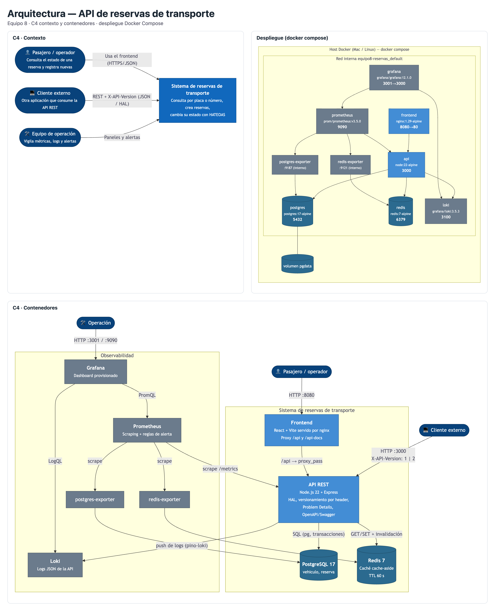
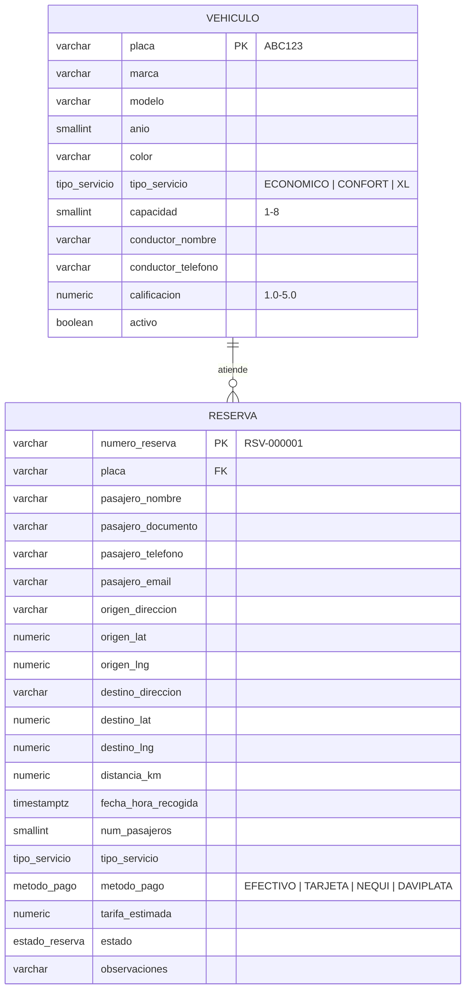
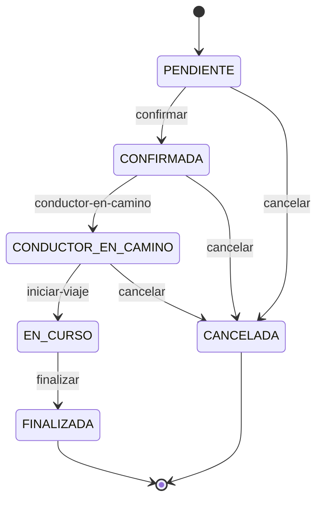
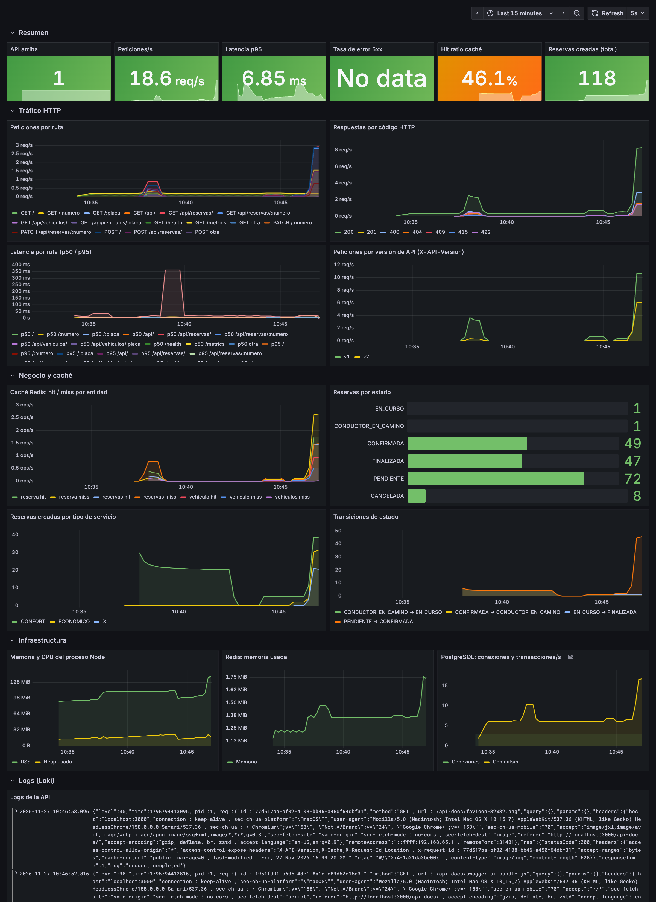
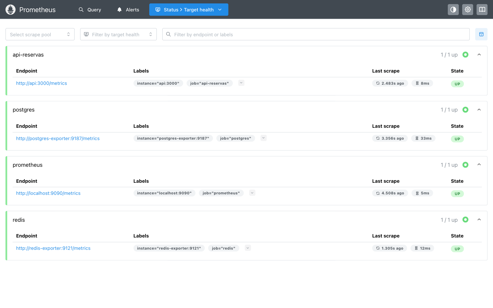
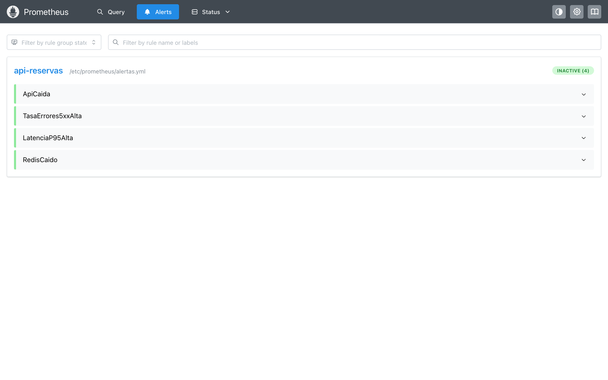
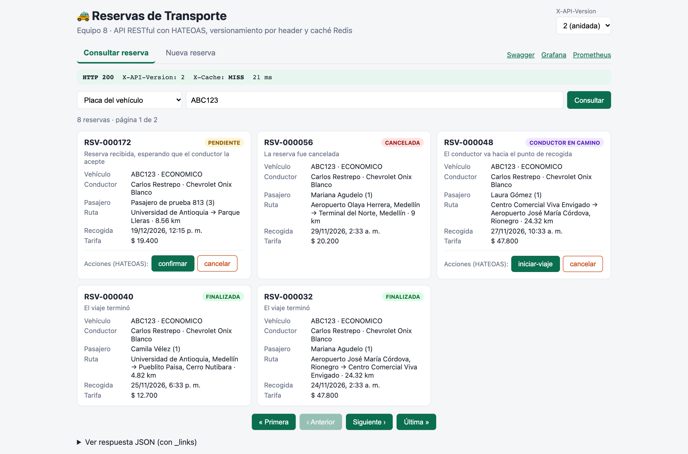
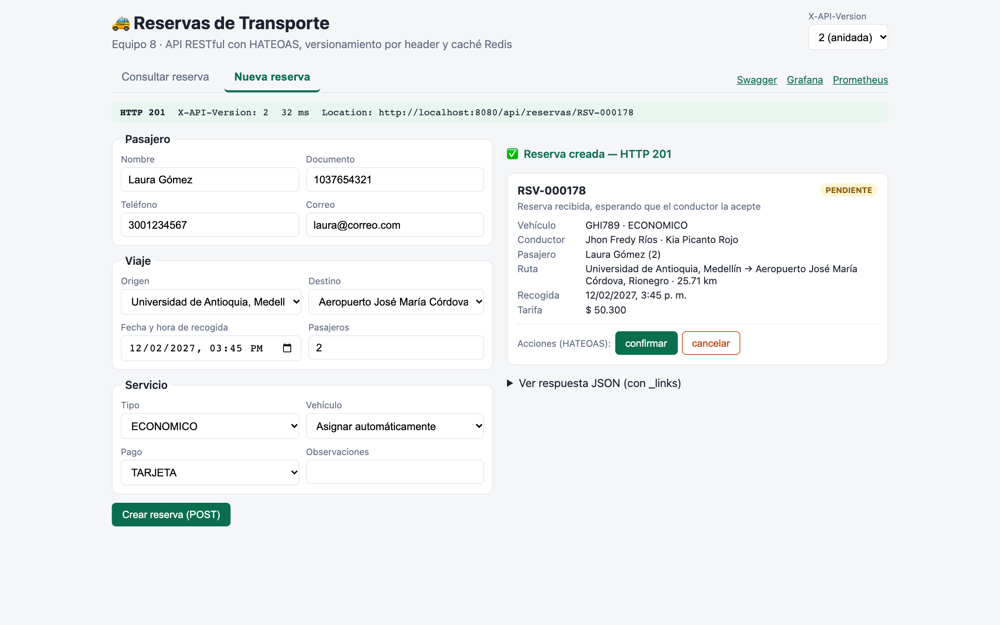
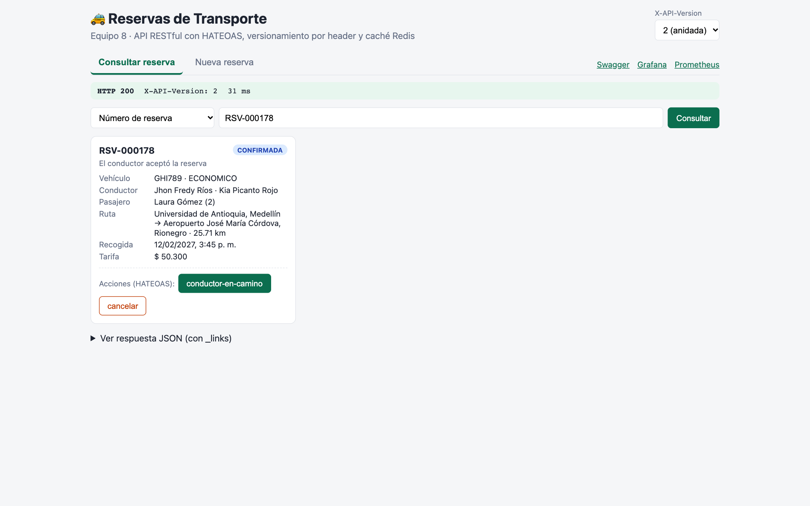
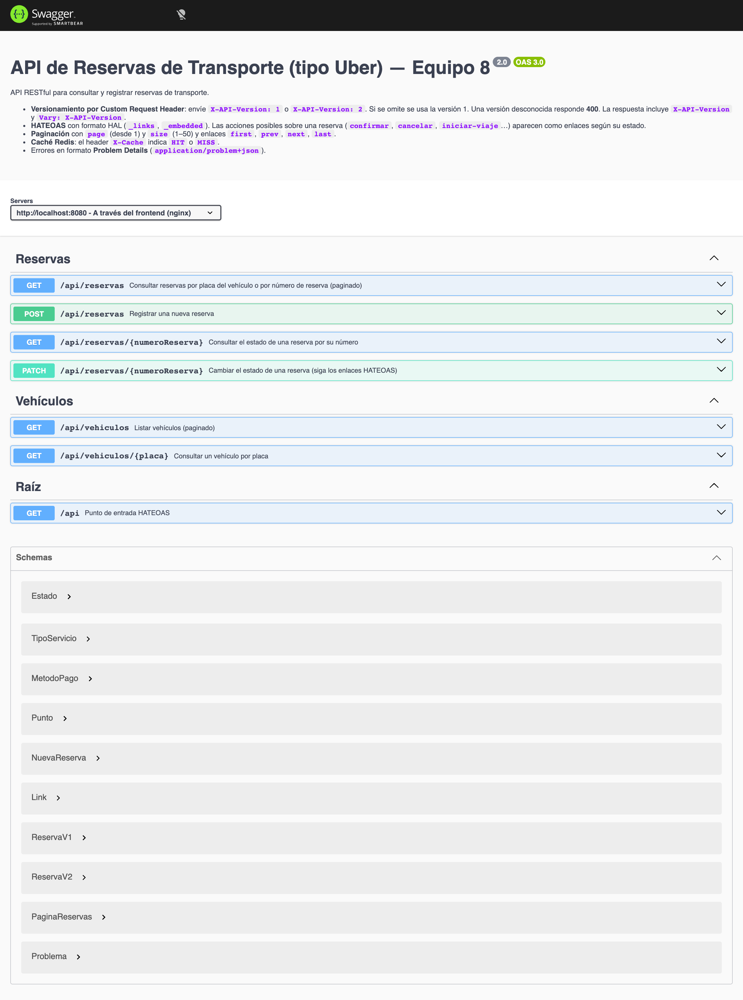

# Informe — API REST de reservas de transporte (tipo Uber)

**Equipo 8** · [@edu-delahoz](https://github.com/edu-delahoz) · [@IvanVelezQu](https://github.com/IvanVelezQu) · [@jorge-ruizf](https://github.com/jorge-ruizf) · [@c4rlosaucu](https://github.com/c4rlosaucu) · [@Alexa0723](https://github.com/Alexa0723)

Repositorio: <https://github.com/edu-delahoz/equipo8-reservas-transporte>

## 1. Objetivo

Construir un servicio web RESTful que permita **consultar el estado de una reserva de transporte**, por la placa del vehículo o por el número de reserva, y **registrar nuevas reservas**. El servicio debía tener base de datos, especificación OpenAPI con Swagger, respuestas JSON, versionamiento por *custom request header*, HATEOAS, buen uso de los códigos HTTP, contenedores Docker y observabilidad. Se añadió un frontend en React para usarlo de punta a punta.

## 2. Proceso de trabajo

1. **Diseño del dominio.** Se definieron dos entidades (`vehiculo` y `reserva`), los estados de una reserva y sus transiciones válidas, y la regla de tarifa.
2. **Base y API.** Primero el esquema SQL con datos de ejemplo, luego la API por capas: configuración y errores, versionamiento, reglas de negocio, repositorio, representaciones HAL y rutas.
3. **Transversales.** Logs estructurados, métricas Prometheus y caché Redis se agregaron como *middleware* y utilidades, sin tocar la lógica de negocio.
4. **Frontend.** Cliente HTTP que envía `X-API-Version` y normaliza v1/v2, pantalla de consulta con paginación y acciones HATEOAS, y formulario de nueva reserva.
5. **Observabilidad y despliegue.** Prometheus con reglas de alerta, Grafana con *dashboard* provisionado, Loki para logs y exporters de Redis y PostgreSQL, todo en `docker-compose.yml`.
6. **Pruebas y evidencias.** 28 pruebas de integración contra el stack levantado, script de tráfico, capturas y salidas de `curl`.

Se trabajó con ramas `main` ← `develop` ← ramas de trabajo, y los commits se repartieron por responsabilidad:

| Integrante | Responsabilidad principal |
|---|---|
| edu-delahoz | Estructura del proyecto, `docker-compose`, esquema de BD, base del frontend, informe |
| IvanVelezQu | Núcleo de la API (configuración, errores, versionamiento, app Express), cliente HTTP, script de tráfico |
| Jorge Andrés Ruiz Flores | Dominio y máquina de estados, repositorio, HATEOAS, rutas de reservas, pantalla de consulta, capturas |
| Carlos Aucu | Logs, métricas, caché, observabilidad, nginx, diagramas de arquitectura |
| Alexa0723 | Vehículos, OpenAPI, formulario y estilos, pruebas de integración, evidencias con `curl` |

## 3. Arquitectura

El detalle (C4 de contexto y contenedores, despliegue y flujo de caché) está en [ARQUITECTURA.md](ARQUITECTURA.md).



| Capa | Tecnología |
|---|---|
| Frontend | React 19 + Vite, servido por nginx 1.29 (proxy `/api` → API) |
| API | Node.js 22 + Express, `swagger-ui-express`, `pino`, `prom-client`, `ioredis`, `pg` |
| Datos | PostgreSQL 17 |
| Caché | Redis 7 (cache-aside, TTL 60 s) |
| Observabilidad | Prometheus 3.5, Grafana 12.1, Loki 3.5, redis-exporter, postgres-exporter |
| Despliegue | Docker Compose, 9 contenedores |

## 4. Decisiones de diseño

| Decisión | Alternativas | Por qué |
|---|---|---|
| Versionamiento con el header `X-API-Version` (1 o 2; si falta, 1; otro valor → `400`) | Versión en la URL (`/v1/…`), *media type* | Lo pide el enunciado (*custom request header*) y permite que la URL de un recurso no cambie entre versiones. |
| v1 **plana** y v2 **anidada** (vehículo, pasajero, ruta y tarifa como objetos) | Solo renombrar campos | Muestra un cambio de contrato real que justifica una versión nueva. |
| HATEOAS en formato **HAL** (`_links`, `_embedded`) | JSON:API, Siren | Es simple, lo entienden muchos clientes y basta para exponer enlaces y acciones. |
| Las acciones (`confirmar`, `cancelar`, `iniciar-viaje`…) aparecen en `_links` **solo si el estado actual las permite** | Enlaces fijos | El cliente no necesita conocer la máquina de estados: la descubre en la respuesta. El frontend dibuja los botones a partir de esos enlaces. |
| Errores en **Problem Details** (RFC 9457, `application/problem+json`) | Formato propio | Estándar, con `type`, `title`, `status`, `detail` y lista de errores por campo. |
| Número de reserva legible `RSV-000001` generado por secuencia | UUID | Fácil de dictar y de buscar; la secuencia evita choques. |
| Asignación automática de vehículo si no se envía placa | Exigir placa | Se parece al funcionamiento de una app tipo Uber. |
| Bloqueo de choques: un vehículo no puede tener dos reservas activas a menos de una hora | Sin control | Regla de negocio que da sentido al `409 Conflict`. Se hace dentro de una transacción con `SELECT … FOR UPDATE`. |
| Caché **cache-aside** con invalidación por clave y por *generación* de listados | Write-through, sin caché | Las consultas son mucho más frecuentes que las escrituras. La generación evita borrar claves con `SCAN`. |
| Una sola API (monolito modular) | Microservicios | El alcance es pequeño; separar capas internas basta y simplifica pruebas y despliegue. |

## 5. Endpoints

Base: `http://localhost:3000/api`. Documentación interactiva en `http://localhost:3000/api-docs` (OpenAPI 3, archivo [`api/openapi.yaml`](../api/openapi.yaml)).

| Método | Ruta | Descripción | Códigos |
|---|---|---|---|
| GET | `/api` | Raíz HATEOAS con los enlaces de entrada | 200, 400 |
| GET | `/api/reservas?placa=&numero=&estado=&page=&size=` | Lista paginada filtrada por placa, número o estado | 200, 400 |
| GET | `/api/reservas/{numeroReserva}` | Una reserva por su número | 200, 400, 404 |
| POST | `/api/reservas` | Crea una reserva (calcula distancia y tarifa, asigna vehículo si no se envía placa) | 201, 400, 409, 413, 415, 422 |
| PATCH | `/api/reservas/{numeroReserva}` | Cambia el estado según las transiciones permitidas | 200, 404, 409, 415, 422 |
| GET | `/api/vehiculos?tipoServicio=&page=&size=` | Lista paginada de vehículos | 200, 400 |
| GET | `/api/vehiculos/{placa}` | Un vehículo con sus enlaces a reservas | 200, 400, 404 |
| GET | `/health` | Estado de PostgreSQL y Redis | 200, 503 |
| GET | `/metrics` | Métricas en formato Prometheus | 200 |

**Paginación:** `page` desde 1, `size` de 1 a 50 (por defecto 10), con enlaces `first`, `prev`, `next` y `last` y un bloque `page` con totales.

**Uso de códigos HTTP:**

| Código | Cuándo |
|---|---|
| 200 | Consulta o cambio de estado correcto |
| 201 | Reserva creada, con cabecera `Location` |
| 400 | Versión no soportada, JSON mal formado, parámetros de consulta inválidos (placa, número, paginación) |
| 404 | Reserva, vehículo o ruta inexistente |
| 409 | Vehículo ocupado o inactivo, sin vehículos libres, transición de estado no permitida |
| 413 | Cuerpo de más de 20 KB |
| 415 | `Content-Type` distinto de `application/json` |
| 422 | Cuerpo JSON con campos inválidos (lista de errores por campo) |
| 500 / 503 | Error inesperado / base de datos caída en `/health` |

### Ejemplo de respuesta v2 con HATEOAS

```json
{
  "numeroReserva": "RSV-000178",
  "estado": { "codigo": "CONFIRMADA", "descripcion": "El conductor aceptó la reserva" },
  "_embedded": { "vehiculo": { "placa": "GHI789", "marca": "Kia", "modelo": "Picanto" } },
  "_links": {
    "self":     { "href": "http://localhost:3000/api/reservas/RSV-000178" },
    "vehiculo": { "href": "http://localhost:3000/api/vehiculos/GHI789" },
    "conductor-en-camino": { "href": "…/reservas/RSV-000178", "method": "PATCH", "body": { "estado": "CONDUCTOR_EN_CAMINO" } },
    "cancelar": { "href": "…/reservas/RSV-000178", "method": "PATCH", "body": { "estado": "CANCELADA" } }
  }
}
```

## 6. Modelo de datos



- Restricciones en la propia base: formato de placa (`^[A-Z]{3}[0-9]{3}$`), rangos de año, capacidad, pasajeros y calificación, y tipos `ENUM` para servicio, pago y estado.
- Índices: `(placa, fecha_hora_recogida DESC)` para la consulta por placa y `(estado)` para el filtro por estado.
- Datos de ejemplo: 8 vehículos y 120 reservas en lugares reales de Medellín y el Valle de Aburrá.

**Reglas de negocio**

- Distancia: fórmula de Haversine × 1,3 (recorrido por calles frente a línea recta).
- Tarifa: `4.000 + km × valor por km` (Económico 1.800, Confort 2.500, XL 3.200), redondeada a centenas, con un mínimo de 7.000 COP.
- La recogida no puede estar en el pasado ni a más de 90 días; el número de pasajeros no puede superar la capacidad del vehículo.

**Máquina de estados**



## 7. Observabilidad

| Pieza | Qué aporta |
|---|---|
| **Métricas** (`/metrics`, `prom-client`) | `http_requests_total` y `http_request_duration_seconds` por método, ruta, código y versión; `cache_operations_total` (hit/miss por entidad); `reservas_creadas_total`, `reservas_transiciones_total`, `reservas_por_estado`; métricas del proceso Node. |
| **Prometheus** | Recoge la API, `redis-exporter`, `postgres-exporter` y a sí mismo cada pocos segundos. |
| **Alertas** | `ApiCaida` (crítica, API sin responder 30 s), `TasaErrores5xxAlta` (> 5 % durante 1 min), `LatenciaP95Alta` (p95 > 500 ms durante 2 min), `RedisCaido`. |
| **Grafana** | *Dashboard* provisionado «API Reservas de Transporte — Equipo 8»: resumen (API arriba, peticiones/s, p95, tasa 5xx, *hit ratio*, reservas creadas), tráfico por ruta, código y versión, caché, negocio, infraestructura y logs. |
| **Loki** | Logs JSON de la API (`pino-loki`) con `X-Request-Id`, consultables desde Grafana. |
| **Health check** | `/health` informa el estado de PostgreSQL y Redis y lo usa Docker para el `healthcheck`. |

Para llenar los paneles se usa [`scripts/trafico.sh`](../scripts/trafico.sh), que mezcla consultas por placa y número (v1 y v2, con aciertos de caché), altas, cambios de estado y errores 400, 404, 409, 415 y 422.



| Prometheus: targets | Prometheus: alertas |
|---|---|
|  |  |

## 8. Pruebas

Las 28 pruebas de integración (`api/tests/api.test.mjs`, con `node:test`) corren contra el stack levantado y cubren:

| Grupo | Qué verifica |
|---|---|
| Versionamiento | v1 por defecto, v1 plana frente a v2 anidada, `400` con versión desconocida, `Vary: X-API-Version` |
| Consulta | Por placa y por número, paginación con enlaces, `400` por formatos inválidos, `404` |
| Caché | `X-Cache: MISS` y luego `HIT`; la reserva nueva aparece al consultar su placa (invalidación) |
| POST | `201` con `Location`, asignación automática de vehículo, `409` por choque de horario, `415`, `400` con JSON mal formado, `422` con errores por campo, fecha en el pasado y placa que no corresponde |
| HATEOAS | Las acciones de `_links` cambian con el estado; transición inválida → `409` |
| Raíz, vehículos y salud | Raíz HATEOAS, `/vehiculos`, `/health` y `/metrics` |

```bash
docker compose up -d --build
cd api && npm test     # tests 28 · pass 28 · fail 0
```

La salida completa de `npm test` y las respuestas reales de `curl` para cada código HTTP, v1 frente a v2 y la caché están en [evidencias/curl.md](evidencias/curl.md).

## 9. Evidencias

| Evidencia | Archivo |
|---|---|
| Consulta por placa con paginación | [frontend-consulta.png](evidencias/frontend-consulta.png) |
| Nueva reserva creada (201) | [frontend-nueva-reserva.png](evidencias/frontend-nueva-reserva.png) |
| Acción HATEOAS: la reserva pasó a CONFIRMADA y ofrece las siguientes acciones | [frontend-accion-hateoas.png](evidencias/frontend-accion-hateoas.png) |
| Swagger UI | [swagger.png](evidencias/swagger.png) |
| Grafana tras el tráfico | [grafana-dashboard.png](evidencias/grafana-dashboard.png) |
| Prometheus: targets y alertas | [prometheus-targets.png](evidencias/prometheus-targets.png), [prometheus-alertas.png](evidencias/prometheus-alertas.png) |
| `curl` por código HTTP, versiones, caché y `npm test` | [curl.md](evidencias/curl.md) |

| Consulta | Nueva reserva |
|---|---|
|  |  |

| Acción HATEOAS | Swagger |
|---|---|
|  |  |

## 10. Cómo ejecutarlo

```bash
git clone https://github.com/edu-delahoz/equipo8-reservas-transporte.git
cd equipo8-reservas-transporte
docker compose up -d --build
```

| Servicio | URL |
|---|---|
| Frontend | http://localhost:8080 |
| API | http://localhost:3000/api |
| Swagger | http://localhost:3000/api-docs |
| Grafana (admin/admin) | http://localhost:3001 |
| Prometheus | http://localhost:9090 |

## 11. Conclusiones

- El versionamiento por header deja estable la URL de cada recurso y permite convivir dos contratos; el costo es que el cliente debe enviar la cabecera y que la respuesta debe declarar `Vary: X-API-Version` para las cachés intermedias (en Redis se guarda el dato y la representación se arma por versión).
- HATEOAS resultó útil en la práctica: el frontend no conoce la máquina de estados, solo pinta los botones que llegan en `_links`.
- Problem Details y los `422` con errores por campo hacen que el formulario muestre mensajes precisos sin lógica extra.
- Tener métricas, logs y alertas desde el principio facilitó depurar durante el desarrollo, no solo operar al final.
- Con Docker Compose todo el sistema (9 contenedores) se levanta con un comando, lo que hizo reproducibles las pruebas de integración.
